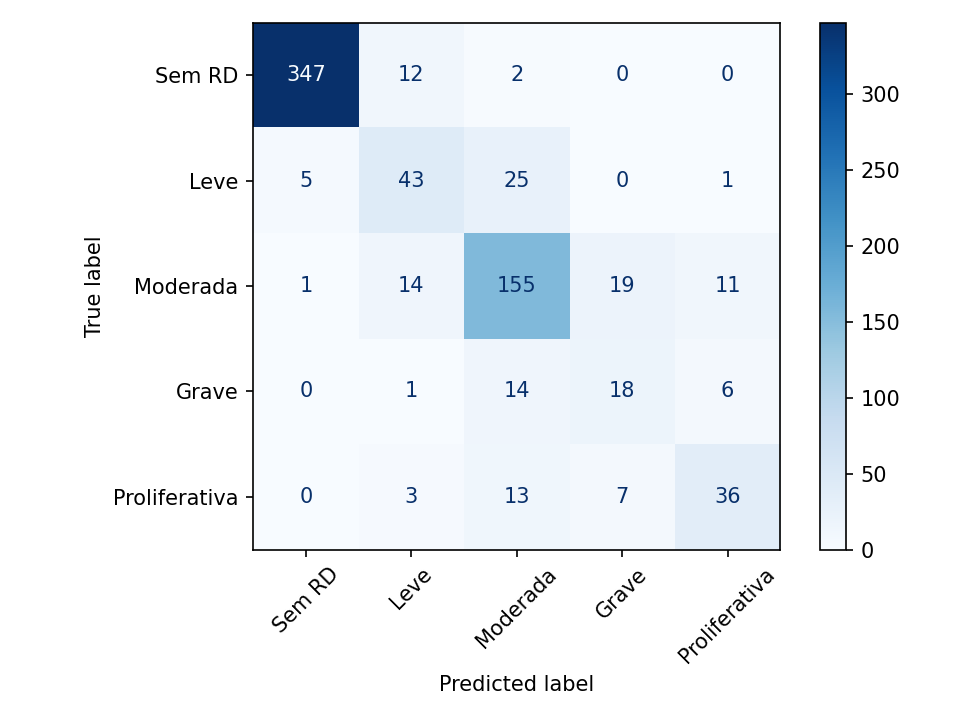

# 👁️ Triagem de Retinopatia Diabética com Deep Learning

Classificação de imagens de fundo de olho em 5 graus de retinopatia diabética (RD), com **explicabilidade (Grad-CAM)**, API de inferência e deploy em Docker.

> ⚠️ Projeto educacional. Não é dispositivo médico. Veja o [Model Card](MODEL_CARD.md).

## Destaques
- Transfer learning com **EfficientNet-B0**
- Pré-processamento de Ben Graham para realçar lesões
- Tratamento de **desbalanceamento de classes**
- Métrica oficial da competição: **Quadratic Weighted Kappa**
- Métrica clínica: AUC de **encaminhamento** (RD moderada ou pior)
- **Grad-CAM** implementado do zero
- API **FastAPI** + exportação **ONNX** + **Docker**

## Resultados
Resultados nos 733 casos de validação (20% do APTOS 2019, seed 42), também usados para escolher a melhor época. Por isso, os valores tendem a ser otimistas; veja as limitações no [Model Card](MODEL_CARD.md). Os dados completos estão em [`docs/metrics.json`](docs/metrics.json).

| Métrica | Valor |
|---|---|
| Quadratic Weighted Kappa | 0,898 |
| AUC de encaminhamento (grau ≥ 2) | 0,986 |
| Acurácia | 0,817 |
| Sensibilidade de encaminhamento (grau previsto ≥ 2) | 0,936 (279 de 298) |
| Especificidade de encaminhamento (grau previsto ≥ 2) | 0,936 (407 de 435) |

| Grau | Recall | Casos |
|---|---|---|
| Sem RD | 0,961 | 361 |
| Leve | 0,581 | 74 |
| Moderada | 0,775 | 200 |
| Grave | 0,462 | 39 |
| Proliferativa | 0,610 | 59 |



### Exemplos de Grad-CAM
Os exemplos não são publicados aqui porque contêm imagens do APTOS, e as [regras da competição](https://www.kaggle.com/competitions/aptos2019-blindness-detection/rules) proíbem redistribuir os dados a quem não participa dela. Quem tem acesso ao dataset pode gerá-los com `scripts/gradcam_demo.py`; os arquivos ficam em `docs/`, ignorados pelo Git.

Inspecionei a primeira imagem de cada grau na validação, sem seleção manual: 3 acertos e 2 erros. Nesses exemplos, o mapa muitas vezes destaca o disco óptico ou a periferia, e não as lesões mais visíveis. Isso não confirma que o modelo se baseia em lesões reais.

## Como rodar
Requer Python 3.11.

```bash
pip install -r requirements.txt

# 1. Baixe o APTOS 2019 (veja a seção abaixo)

# 2. Treine (sem GPU, use o notebook train_colab.ipynb)
python -m src.dr.train --data data/aptos --epochs 15

# 3. Avalie (grava docs/metrics.json e docs/confusion_matrix.png)
python -m src.dr.evaluate --data data/aptos --weights models/best.pt

# 4. Gere exemplos de Grad-CAM em docs/
python scripts/gradcam_demo.py --data data/aptos --weights models/best.pt

# 5. Suba a API
uvicorn api.main:app --reload
curl -F "file=@exemplo.png" http://localhost:8000/predict

# 6. Ou abra a demo em Gradio
python app.py
```

Docker: `docker build -t dr-screening . && docker run -p 8000:8000 dr-screening`. Coloque `models/best.pt` antes do build; sem os pesos, a API sobe, mas `/predict` responde 503.

Testes: `pytest` (usam imagens sintéticas e não baixam nada).

Para testar o pipeline sem o dataset real:
```bash
python scripts/make_synthetic_data.py --out data/synthetic
python -m src.dr.train --data data/synthetic --epochs 1 --bs 8 --out models/smoke.pt
```

### Baixar o APTOS 2019
São cerca de 10 GB.

1. Aceite as regras da [competição](https://www.kaggle.com/competitions/aptos2019-blindness-detection/rules); sem isso, o download dá erro 403.
2. Instale o CLI e faça login:
   ```bash
   pip install kaggle six
   kaggle auth login
   ```
   Como alternativa, gere um token em [kaggle.com/settings](https://www.kaggle.com/settings) e defina a variável `KAGGLE_API_TOKEN`.
3. Baixe e extraia só o necessário em `data/aptos/` (o `tar` também funciona no Windows 10 ou superior):
   ```bash
   kaggle competitions download -c aptos2019-blindness-detection -p data/aptos
   tar -xf data/aptos/aptos2019-blindness-detection.zip -C data/aptos train.csv train_images
   ```

O resultado deve ser `data/aptos/train.csv` e `data/aptos/train_images/`, com 3.662 imagens PNG.

## Estrutura
```
src/dr/            data, model, train, evaluate, gradcam, inference, export_onnx
api/               FastAPI
scripts/           gradcam_demo, make_synthetic_data, check_duplicates
tests/             testes do pipeline e de ponta a ponta
app.py             demo em Gradio (veja docs/huggingface_space.md)
train_colab.ipynb  treino no Google Colab
```

## Próximos passos
- [x] Treinar e preencher métricas
- [ ] Comparar com ConvNeXt/ViT e ensemble
- [ ] Regressão ordinal em vez de classificação
- [ ] Calibração de probabilidades e detecção de imagens fora de distribuição
- [ ] Publicar a demo no Hugging Face Spaces
- [x] CI com GitHub Actions
